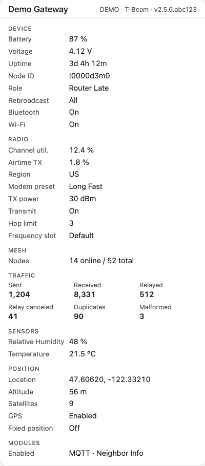
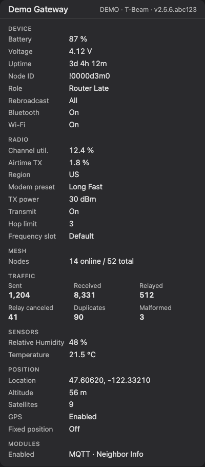

# Meshtastic Cards

Custom [Lovelace](https://www.home-assistant.io/dashboards/) cards for [Home Assistant](https://www.home-assistant.io/) that work with the [`meshtastic` integration](https://github.com/ch0ppy35/meshtastic-home-assistant). One install gives you:

- **Meshtastic Chat** (`custom:meshtastic-chat-card`): channel messages, with history, live updates and optional sending.
- **Meshtastic Radio** (`custom:meshtastic-radio-card`): everything the integration knows about your gateway radio, including battery, airtime, LoRa config, mesh and traffic stats, sensors and position.

Both cards share the same look: a compact header, grouped rows, and a brief flash when something changes live.

## Screenshots

**Chat**


**Radio** (light and dark theme)

<p>
  
  
</p>

## Installation

### Prerequisites

> [!WARNING]
> Before using these cards, please ensure you have the [Meshtastic integration](https://github.com/ch0ppy35/meshtastic-home-assistant) installed in your Home Assistant instance, with at least one connected gateway. The chat card needs a channel entity (`device_class: channel`); the radio card needs the gateway entity (`device_class: gateway`).

### HACS (Recommended)

1. Open HACS in your Home Assistant instance
2. Click the menu icon in the top right and select "Custom repositories"
3. Add this repository URL and select "Dashboard" as the category
   - `https://github.com/ch0ppy35/meshtastic-integration-cards`
4. Click "Install"
5. Reload your browser

Both cards ship in a single file (`meshtastic-chat-card.js`), so there is only one resource to install.

### Manual Installation

1. Download the `meshtastic-chat-card.js` file from the [latest release](https://github.com/ch0ppy35/meshtastic-integration-cards/releases).
2. Copy it to your `www/community/meshtastic-chat-card/` folder.
3. Add the following to your `configuration.yaml` (or add as a resource in the Dashboards menu):

```yaml
lovelace:
  resources:
    - url: /local/community/meshtastic-chat-card/meshtastic-chat-card.js
      type: module
```

1. Reload your browser.

## Chat card

### Features

- **History backfill**: on load, pulls up to 7 days of past messages from the HA logbook (`logbook/get_events`).
- **Send messages**: an optional, opt-in composer sends to the configured channel through the integration's `meshtastic.broadcast_channel_message` service. Sent messages appear in the log as **You** once the integration reports them: it fires `meshtastic_message_log` with `direction: "out"` and writes a logbook entry. That means sent messages also persist across reloads and show on every dashboard.

### Card Editor

The card is fully configurable through the card editor, allowing you to customize:

- Channel entity selection (auto-discovers the primary Meshtastic channel)
- Card title
- Message limit
- Timestamp display
- Sort order
- Send composer (optional)

### YAML

This is the most minimal configuration needed to get started:

```yaml
type: custom:meshtastic-chat-card
channel_entity: meshtastic.my_gateway_channel_primary
```

### Configuration options

| Option            | Type      | Default | Description                                                                                                                                     |
| :---------------- | :-------- | :------ | :---------------------------------------------------------------------------------------------------------------------------------------------- |
| `channel_entity`  | `string`  | —       | **Required.** Entity ID of the Meshtastic channel to display (`device_class: channel`).                                                         |
| `title`           | `string`  | —       | Card title. Defaults to the channel entity's `friendly_name`.                                                                                   |
| `limit`           | `number`  | `200`   | Maximum number of messages to render. Oldest messages are dropped first.                                                                        |
| `show_timestamps` | `boolean` | `true`  | Show the date and time (for example, `May 7, 14:30`) at the start of each message row. Hover a row to see full second-level precision.          |
| `sort_order`      | `string`  | `desc`  | `desc` = newest messages first (top), `asc` = oldest messages first (bottom). The header button overrides this setting for the current session. |
| `enable_send`     | `boolean` | `false` | Show a composer at the top of the card to send messages to the configured channel via `meshtastic.broadcast_channel_message`.                   |

A 🔒 badge is always shown next to messages delivered via a PKI/direct encrypted link.

### Full YAML example

```yaml
type: custom:meshtastic-chat-card
channel_entity: meshtastic.my_gateway_channel_primary
title: 'Base Camp Chat'
limit: 100
show_timestamps: true
sort_order: desc
enable_send: true
```

### Finding Your Channel Entity

If you're unsure which channel entity to use, here are a couple of ways to find it:

#### Method 1: Use the Card Editor (Recommended)

1. Add the card through the visual editor
2. The editor will pre-select the primary Meshtastic channel entity if one exists
3. Click "Show Code Editor" to see the generated YAML and copy the `channel_entity` value

#### Method 2: Developer Tools

1. Go to **Developer Tools** → **States**
2. Filter for `meshtastic.` and look for entities with `device_class: channel`
3. Use the entity ID (e.g. `meshtastic.my_gateway_channel_primary`)

## Radio card

### What it shows

The card starts from the gateway entity, finds its device, and reads the sensors that the integration attaches to that device. Values update live, and a row flashes briefly when its value changes. Sections or rows with no data are hidden.

| Section      | Rows                                                                                                                                    |
| :----------- | :-------------------------------------------------------------------------------------------------------------------------------------- |
| **Header**   | Device name, then short name · hardware model · firmware version (plus `Disconnected` if the gateway is offline)                        |
| **Device**   | Battery (and whether it is powered), voltage, uptime, node ID, role, rebroadcast mode, Bluetooth, Wi-Fi                                 |
| **Radio**    | Channel utilization, TX airtime, region, modem preset (or custom bandwidth/SF/CR), TX power, transmit on/off, hop limit, frequency slot |
| **Mesh**     | Nodes online / total                                                                                                                    |
| **Traffic**  | Packets sent, received, relayed, relay canceled, duplicates, malformed                                                                  |
| **Sensors**  | Any environment, air quality or power telemetry the radio reports (temperature, humidity, pressure, PM2.5, …)                           |
| **Position** | Location, altitude and satellites from the node's device tracker; GPS mode; fixed position                                              |
| **Modules**  | Which modules are enabled (MQTT, Store & Forward, Range Test, Neighbor Info, …)                                                         |

> [!NOTE]
> The gateway entity's attributes also hold sensitive config such as the Wi-Fi PSK, MQTT password and private keys. The card only reads a fixed allowlist of safe fields, so **secrets are never displayed**. Set `show_config: false` to hide config rows entirely and show only live telemetry.

### Card Editor

Add **Meshtastic Radio** from the card picker. The editor pre-selects your gateway entity and lets you set the title, choose sections, and toggle config rows.

### YAML

```yaml
type: custom:meshtastic-radio-card
gateway_entity: meshtastic.gateway_base
```

### Configuration options

| Option           | Type      | Default      | Description                                                                                                         |
| :--------------- | :-------- | :----------- | :------------------------------------------------------------------------------------------------------------------ |
| `gateway_entity` | `string`  | —            | **Required.** Entity ID of the Meshtastic gateway (`device_class: gateway`).                                        |
| `title`          | `string`  | —            | Card title. Defaults to the gateway device's name.                                                                  |
| `sections`       | `list`    | all sections | Which sections to show: `device`, `radio`, `mesh`, `traffic`, `environment`, `position`, `modules`. Order is fixed. |
| `show_config`    | `boolean` | `true`       | Show the radio config rows (role, region, modem preset, TX power, modules, …). `false` shows only sensor data.      |

### Full YAML example

```yaml
type: custom:meshtastic-radio-card
gateway_entity: meshtastic.gateway_base
title: 'Roof Radio'
sections:
  - device
  - radio
  - mesh
  - traffic
show_config: true
```

### Finding Your Gateway Entity

Go to **Developer Tools** → **States**, filter for `meshtastic.gateway_`, and use that entity ID. The card editor also pre-selects it for you.

The card matches sensors by the entity IDs the integration creates (for example `sensor.meshtastic_base_1234_device_battery_level`). If you rename those entity IDs, the matching rows disappear from the card. Renaming _friendly names_ is fine.

## Development

```bash
# Install dependencies
yarn install

# Start the dev rollup (rebuild on save, serves the bundle on :5001)
yarn start

# Production build → dist/meshtastic-chat-card.js (both cards)
yarn build

# Type-check src/ and demo/
yarn typecheck

# Lint
yarn lint
```

The dev build registers the cards as `meshtastic-chat-card-dev` and `meshtastic-radio-card-dev` so they can coexist with the production cards in the same HA instance. The `DEV` flag is injected at build time by `@rollup/plugin-replace` (`true` in `rollup.config.dev.js`, `false` in `rollup.config.js`), so there's nothing to flip by hand before cutting a release.

Source layout: `src/index.ts` is the bundle entry and imports each card. `src/register.ts` holds the shared card-picker registration. Each card is a thin Lit element (`chat-card.ts`, `radio-card.ts`) over pure, unit-tested helpers (`history.ts`, `live.ts`, `messages.ts`, `discovery.ts`, `radio.ts`). Shared styles live in `styles.ts`.

### Where the dev bundle is written

By default `yarn start` writes to `./dist-dev/meshtastic-chat-card.js`. To live-reload directly into a Home Assistant instance, point `DEV_OUTPUT_DIR` at your HA `www` directory:

```bash
DEV_OUTPUT_DIR=/path/to/homeassistant/config/www yarn start
```

Then in HA, register the resource at **Settings → Dashboards → Resources** as `/local/meshtastic-chat-card.js` with type **JavaScript module** ([HA docs](https://developers.home-assistant.io/docs/frontend/custom-ui/registering-resources)).

### Standalone preview page

For iterating on the UI without a Home Assistant instance, run the demo
harness:

```bash
yarn demo
```

This bundles the cards plus a small preview page and serves it on
<http://localhost:5050>. The page mounts both cards against a stubbed `hass`
object backed by mock logbook history and a fake gateway device. It also
exposes a controls panel:

- Chat: `title`, `limit`, `sort_order`, `show_timestamps`, `enable_send`
- Container width / height (HA's grid sizing doesn't apply on a vanilla page)
- An **Inject message** button that fires a fake `meshtastic_message_log`
  event so you can see the live-flash animation
- A **Replay history** button that rebuilds the mock logbook
- Radio: `show_config`, a **gateway connected** toggle, and a **Randomize
  telemetry** button that pushes new sensor states through `hass` so changed
  rows flash

Send a message with `enable_send` on and the harness reports it back through
the live event stream as an outbound message. It also logs the `callService`
payload to the browser console, so you can check the full round-trip without a
radio.

The fake gateway includes secret config attributes on purpose, so the demo
also shows that they never render.

The screenshots in this README are taken from the demo page.

### Testing the live message path without a radio

The chat card subscribes to the `meshtastic_message_log` event bus. To exercise the live render path without a real Meshtastic gateway, fire a fake event from HA's **Developer Tools → Events**:

- Event type: `meshtastic_message_log`
- Event data:

  ```yaml
  entity_id: meshtastic.your_channel_entity
  from_name: Tester
  message: hello from devtools
  pki: false
  ```

### Testing

```bash
# Run the unit and component test suites
yarn test

# Watch mode
yarn test:watch

# Coverage report
yarn test:coverage
```

Tests live under `src/__tests__/` and run on [Vitest](https://vitest.dev/) with `jsdom`. Pure helpers are tested directly. The Lit render tests (`render.test.ts`, `radio-render.test.ts`) mount the real elements against a stubbed `hass`. `src/__tests__/fixtures/radio.ts` models a gateway device the way the integration exposes it, secret attributes included.
